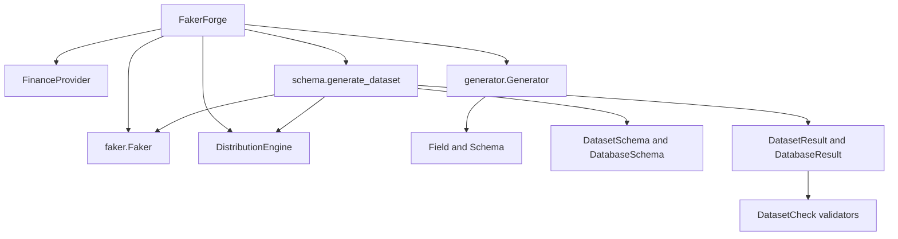

# FakerForge architecture audit

Audit of the published 0.1.0 package. Phase 1 adds a dependency graph, a project plan, and a batch iterator beside the existing API. Later phases are listed in the roadmap and are not implemented here.

## Current architecture

`FakerForge` is a wrapper around `faker.Faker`. Faker remains the value provider. Row generation is pure Python.



Two public schema models coexist:

- Provider rows: `Field` and `Schema` with `Generator.generate`. Each cell calls one Faker method. The result is a `list[dict]`.
- Declarative datasets: `Column`, `DatasetSchema`, `TableSchema`, and `DatabaseSchema`, filled by `generate_dataset`. This path has primitive types, bounds, nulls, uniqueness, age-from-date `derived_from`, date `depends_on`, and single-column foreign keys.

`FakerForge.generate` is the declarative path. `DistributionEngine` keeps a random stream separate from Faker. NumPy is optional and does not emit the same series as the standard library. Pandas is optional and is used only when `DatasetResult.frame` is read.

Column and table order both go through one topological sort. Phase 1 moves that sort into `fakerforge.graph` and keeps the declaration-index tie break.

## Current public API

The root package exports `FakerForge` and `__version__` only.

These import paths are public:

- `FakerForge(locale, *, seed, providers)`, `.faker`, `.seed_instance`, `.distributions`, `.number`, `.categorical`, `.generate(schema, *, rows)`, `.add_provider`, and attribute delegation to Faker
- `fakerforge.generator.Generator`
- `fakerforge.schema`: `Field`, `Schema`, `Column`, `DatasetSchema`, `DatabaseSchema`, `TableSchema`, `DatasetResult`, `DatabaseResult`, `SchemaError`, `GenerationError`
- `fakerforge.validation`: `Validator`, `ValidationError`, `DatasetCheck`, `ValidationContext`, `ValidationReport`, `Violation`
- `fakerforge.providers`: `ForgeProvider`, `FinanceProvider`
- `fakerforge.distributions`: `Distribution`, `DistributionEngine`, `DistributionError`
- `fakerforge.constraints.Constraint`

Phase 1 adds, without changing the signatures above:

- `FakerForge.load`, `FakerForge.plan`, `FakerForge.iter_batches`
- `fakerforge.core`: `Project`, `GenerationPlan`, `FakerForgeError`, `PlanError`
- `fakerforge.graph`: `DependencyGraph`, `GraphNode`, `GraphEdge`, `topological_order`
- `fakerforge.generation`: `Batch`, `KeyPool`, `iter_batches`

`generate` still returns in-memory `DatasetResult` or `DatabaseResult`. Integer bounds stay inclusive. Float bounds stay half-open. Foreign keys are still copied from unique parent columns that were already generated. Orphans are refused. Many-to-many and self-references stay rejected. Dates stay in 1990-01-01 through 2030-12-31. Derived age is completed years as of 2030-12-31.

Install surface stays Python `>=3.10` and `Faker>=24`. Optional extras are `numpy`, `pandas`, and `yaml`.

## Existing functionality

- Seeded Faker delegation and `FinanceProvider` (`credit_score`, `transaction_amount`, `account_number`)
- Uniform, normal, rejection-truncated normal, log-normal, and weighted categorical sampling
- Single-table and multi-table declarative generation
- Referential integrity for one-to-many and unique one-to-one foreign keys
- Post-generation checks for type, bounds, nulls, uniqueness, a few provider shapes, foreign keys, and row count, plus caller-supplied `DatasetCheck` instances
- Instance seeding. Distribution draws do not consume the Faker stream

## Strengths

- Faker is a dependency, not a fork. Custom providers are normal `BaseProvider` subclasses.
- Schema errors are collected before any row is produced.
- Foreign keys are never invented.
- The distribution stream is isolated from provider calls, so numeric draws can be replayed without counting names or emails.
- Results are validated against the schema that produced them, and a failed report is returned rather than raised.
- The public surface is small and covered by tests on Python 3.10 through 3.13.

## Weaknesses

- `Generator` and `generate_dataset` do not share a graph or a key store.
- `Distribution` and `Constraint` are abstract bases with no built-in implementations. Dataset rules live in the schema parser.
- `derived_from` only computes age from a date. `depends_on` only floors a later date.
- Table `rows` is a fixed integer. There is no scale factor and no parent-table multiplier.
- Schemas are in-memory mappings. 0.1 has no project file, layers, dry-run, or lineage.
- The topological sort returns a flat order, so 0.1 cannot name tables that are free to run together.
- Many-to-many, composite keys, self-references, and cardinality distributions are unsupported.
- There is no Parquet, SQL, CLI, profiling, SCD, checkpointing, or parallelism.

## Scalability bottlenecks

`generate_dataset` builds one dictionary per row and keeps every table in memory:

```python
return [
    _row(forge, schema, methods, pools, seen, parent_keys, fk_pools)
    for _ in range(rows)
]
```

`DatasetResult` copies that list again. There is no batch size and no streaming writer.

Other limits:

- Parent keys are Python lists, then copied into per-column foreign-key pools. Validation builds another set of every parent value.
- Unique integer columns materialize `list(range(...))` up to 1,000,000 values.
- Provider uniqueness retries at most 100 scalar draws.
- Each foreign key draws one scalar uniform index.
- Validation walks every cell after the full dataset exists.
- Pandas materializes a third copy when `frame` is read.

Phase 1 does not make scalar Faker calls faster. `iter_batches` yields fixed-size chunks so the caller can drop rows after writing them. `FakerForge.generate` still materializes the full result, because that is the 0.1 contract.

## Compatibility risks

- Reordering draws, or switching the default distribution backend, changes seeded sequences. NumPy and the standard library are each deterministic and they do not match each other. Reproducibility includes whether NumPy is installed.
- Moving or renaming modules under `fakerforge.schema`, `fakerforge.generator`, `fakerforge.validation`, `fakerforge.providers`, `fakerforge.distributions`, or `fakerforge.constraints` would break callers. Phase 1 adds packages and leaves those paths in place.
- Changing `generate` to return batches, Arrow tables, or file paths would break callers. Batch generation is a new method.
- The topological tie break is part of generation order. The shared sort keeps declaration-index ordering.
- `SchemaError` and `GenerationError` stay subclasses of `ValueError` and `RuntimeError`. They do not become subclasses of the new `FakerForgeError`, so existing `isinstance` checks keep working. `PlanError` is the new error for project documents and dependency cycles reported by the plan API.

## Recommended architecture

Faker stays a provider. New engines own rows, keys, and I/O. Packages are added when a phase needs them.

```text
fakerforge/
    faker.py              0.1 entry point, plus load, plan, iter_batches
    generator/            0.1 Field/Schema rows
    providers/            Faker providers
    distributions/        scalar sampling
    constraints/          per-value predicates
    schema/               declarative schema and in-memory results
    validation/           dataset checks
    graph/                dependency graph and topological sort
    generation/           batches and key pools
    core/                 project documents and generation plans
    relationships/        later: cardinality and many-to-many
    layers/               later: bronze, silver, gold
    storage/              later: Parquet, CSV, SQL
    profiling/            later: profile and compare
    quality/              later: quality reports beyond 0.1 checks
    cli/                  later: command line
    benchmarks/           later: reproducible timings
```

Phase 1 creates `graph/`, `generation/`, and `core/` only.

Target call shape for later phases, with `generate(schema, rows=...)` left intact:

```python
forge = FakerForge(seed=42)
project = forge.load("project.yaml")
plan = forge.plan(project)
for batch in forge.iter_batches(project.tables, batch_size=100_000):
    ...
```

`plan` does not generate rows. YAML is loaded with `yaml.safe_load` when PyYAML is installed. JSON uses the standard library. Neither path executes code from the file.

## Migration plan

No public 0.1 symbol is removed. New behavior is additive. `generate_dataset` keeps its row loop so existing seeds stay on that path. `iter_batches` calls the same row function with the same per-table state machine, and tests require that concatenating batches matches `generate` for the same seed.

Phase 1 is released as `0.2.0`. The changelog records those additions under that version.

| Version | Scope |
| --- | --- |
| 0.2 | Phase 1 graph, project document, generation plan, and batch iterator. Phase 2 medallion metadata and layer order, still using the batch iterator. |
| 0.3 | Phase 3 streaming Parquet. Phase 4 runnable retail project at small scale, with the same file scalable by `scale`. |
| 0.4 | Phase 5 profiling and generate-from-profile with separate similarity metrics. Phase 6 vectorized numeric columns and compact key pools, each justified by a benchmark. |
| 1.0 | Phase 7 CLI and the full README rewrite. Phase 8 benchmark suite. SCD, SQL loaders, checkpoint resume, and domain packs that are stable enough to support. |

Domain providers such as healthcare, finance expansions, retail, and geography stay out of the core install. `FinanceProvider` remains because it shipped in 0.1.

## Phase 1 performance strategy

Phase 1 does not claim a higher row rate. It removes the requirement that the caller retain every row: generation yields chunks of `batch_size`, and the plan reports order before any draw. Scalar provider calls stay inside each chunk. Later phases replace numeric and key columns with NumPy or Arrow only after a benchmark shows the change. The batch iterator remains the write boundary. Parallel workers, when they exist, run only on graph levels with no edge between them, with per-worker seeds, and only after single-thread output is reproducible.
